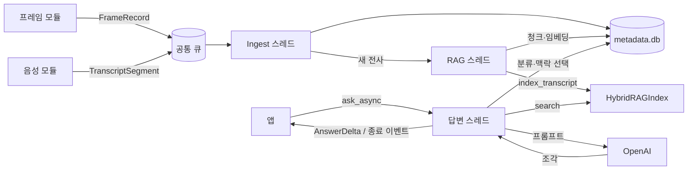

# 맥락 관리·Q&A 모듈 (`context_qa/`)

김혜연 담당 모듈입니다. 프레임·음성 모듈이 보낸 화면과 전사를 SQLite에 저장하고, 학생 질문이 들어오면 질문 종류에 맞는 화면·전사·이전 대화를 골라 GPT에 보내 답변을 스트리밍합니다. 공개 API는 [`interface_spec/contracts.py`](../interface_spec/contracts.py)의 `ContextQAAPI`(`start`, `ask_async`, `cancel_question`, `drain_and_stop`)를 그대로 구현합니다.

## 담당 범위

| 이 모듈이 하는 일 | 이 모듈이 하지 않는 일 |
|---|---|
| 세션 DB(`metadata.db`) 단독 쓰기, 수집 이벤트 저장 | 화면 캡처·중복 제거·프레임 유형 분류 (프레임 모듈) |
| 전사를 RAG에 인덱싱하고 결과 청크 저장 | 음성 인식, 청킹·임베딩·검색 알고리즘 (음성·RAG 모듈) |
| 질문 분류, 질문별 맥락 선택, 프롬프트 구성 | Qt 객체 조작, 세션 상태 전환 (앱) |
| GPT 스트리밍 답변, 취소·실패 처리, 정상 종료 | |

## 전체 흐름



스레드는 세 개입니다. 큐 소비와 저장은 Ingest 스레드, 임베딩·인덱싱은 RAG 스레드, 질문 처리는 답변 스레드가 맡아 서로를 막지 않습니다.

## 파일 구성

| 파일 | 역할 |
|---|---|
| `service.py` | `ContextQAService`: 스레드 관리, 질문 처리, 취소·실패·종료 |
| `store.py` | `ContextStore`: SQLite 저장·조회 (테이블 7개) |
| `classifier.py` | 질문 유형 6종 분류 (키워드 규칙) |
| `selector.py` | 질문 유형별 화면·전사·이전 대화 선택 |
| `prompt.py` | 모델 지침과 프롬프트 구성 |
| `llm.py` | OpenAI 스트리밍 클라이언트, 테스트용 `FakeLLM` |
| `tagfilter.py` | 스트리밍 중 답변 끝의 대화 태그(`<tag>N</tag>`) 제거 |
| `factory.py` | `create_context_qa()`: 앱에서 쓰는 생성 함수 |
| `fakes.py` | 테스트용 `FakeRAG`, `FakeEmbedder` |

## 동작 방식

### 저장

- 큐에서 받은 `FrameRecord`·`TranscriptSegment`를 최대 100개씩 묶어 저장합니다. 같은 ID는 무시하고, 저장에 실패하면 `ModuleError`로 알립니다(조용히 버리지 않음).
- 테이블: `frames`, `frame_history`, `transcripts`, `questions`, `answers`, `text_chunks`, `chunk_embeddings`. 상세는 [DB 설계](../docs/context_qa_db.md).

### RAG 연동

- 새로 저장된 전사만 RAG 스레드로 넘겨 `index_transcript()`를 호출하고, 만들어진 청크와 임베딩을 DB에 저장합니다.
- 세션을 다시 열면 저장된 청크로 인덱스를 복원합니다. 임베딩 모델이 바뀌었으면 알리고 빈 인덱스로 시작합니다.
- `sentence-transformers`가 없으면 키워드 위주의 대체 임베더로 동작하고, 그 사실을 `startup_notes`에 남깁니다.

### 질문 처리

1. 질문을 6종으로 분류합니다(우선순위 순).

   | 유형 | 예 | 추가로 보내는 맥락 |
   |---|---|---|
   | `dispute_answer` 답변 반박 | "아까 너는 …라고 했잖아" | 이전 대화 최대 20개 |
   | `dispute_lecture` 강의 반박 | "교수님은 …라고 했는데 맞나요?" | RAG로 찾은 과거 구간 |
   | `past_visual` 과거 화면 | "아까 나온 그래프" | 과거 구간 + 그 시점 Visual 화면 3장 |
   | `past` 과거 내용 | "아까 설명한 …" | 과거 구간 ±5분 전사 + 화면 4장 |
   | `current_visual` 현재 화면 | "지금 이 코드에서 …" | 최근 화면 중 Visual 우선 8장 |
   | `general` 일반 | 그 외 | 최근 화면 8장 |

2. 공통으로 질문 시작·제출 화면 2장, 최근 10분 전사, 최근 이전 대화 5개(같은 대화 태그는 더)를 넣습니다. 이미지는 최대 10장입니다.
3. 과거 검색은 `search(질문, top_k=5, until_ms=제출 시각)`를 쓰고, 1위 결과가 질문과 단어를 하나도 공유하지 않으면 버립니다. RAG가 없거나 실패하면 일반 질문처럼 처리합니다.
4. **모든 자료는 제출 시각 이전 것만** 씁니다.

### 답변

- GPT 응답을 조각(`AnswerDelta`)으로 바로 넘기고, 질문 하나당 종료 이벤트(`AnswerResult` / `AnswerCancelled` / `AnswerFailed`)는 정확히 한 번 보냅니다.
- 모델이 답변 끝에 붙인 대화 주제 번호(`<tag>N</tag>`)는 떼어 내 `context_tag`로 저장합니다. 같은 번호의 이전 대화는 다음 질문 때 함께 보냅니다.
- 첫 조각이 오기 전의 일시 오류(429, 5xx, 연결)는 한 번 다시 요청합니다.
- 답변마다 첫 조각·전체 시간, 토큰, 모델, 과거 검색 시간, 재시도 횟수를 기록합니다.

### 종료

`drain_and_stop()`은 명세 7장 순서를 따릅니다. 큐에 남은 이벤트 저장 → RAG 인덱싱 마무리와 `flush_pending()` 저장 → RAG 정리 → 진행 중 질문 취소 → DB 닫기. 중간 단계가 실패해도 DB는 닫습니다.

## 앱에서 쓰는 법

```python
from context_qa import create_context_qa

qa = create_context_qa()                  # 실제 GPT + HybridRAGIndex
# qa = create_context_qa(fake_llm=True)   # API 키 없이 UI 개발
qa.start(session_id, session_dir, output_queue, on_answer_event, on_error)
```

`desktop_app/adapters.py`의 `MockContextQA()` 자리에 `create_context_qa()`를 넣으면 연결됩니다. 콜백 스레드, 이벤트별 UI 처리, 오류 코드, 환경변수는 [연결 가이드](../docs/context_qa_usage.md)에 정리했습니다.

필요한 것: `openai==3.49.0`, 환경변수 `OPENAI_API_KEY`, 과거 검색에 `sentence-transformers`. 데모 추천 모델은 `CLUE_MODEL=gpt-6.1-sol`, `CLUE_REASONING_EFFORT=medium`입니다.

## 테스트와 확인

```powershell
# 단위 테스트 (API 키 불필요)
.\.venv\Scripts\python.exe -m unittest discover -s tests -v

# 영상 없이 특정 시점에서 질문 (클로바노트 전사 사용)
.\.venv\Scripts\python.exe -m scripts.offline_replay --transcript-file <전사.txt> --at 14:00 --question "아까 ...는 뭐였지?" --fake-llm

# GUI 없이 실제 프레임 모듈과 연결, 음성 대신 전사 파일 재생
.\.venv\Scripts\python.exe -m scripts.live_session --transcript-file <전사.txt>
```

- 테스트: 이 모듈 125개. main과 프레임·음성·앱 브랜치를 합친 상태에서 전체 181개가 통과했습니다(11/23).
- 다른 스크립트: `demo_context_qa`(이미지 2장 + 짧은 전사로 질문), `show_answers`(질문별 결과 표), `gen_db_doc`(DB 문서 생성).

### 실측 (11/23, 추천 시스템 강의 약 15분)

실제 프레임 모듈 + 클로바노트 전사 재생 + 실제 임베딩, `gpt-6-luna`로 질문 4개를 했습니다.

| 질문 | 분류 | 첫 답변 | 전체 |
|---|---|---|---|
| 현재 화면 (세션 첫 질문) | current_visual | 8.1초 | 9.8초 |
| 과거 내용 | past | 2.8초 | 5.0초 |
| 후속 질문 | general | 3.7초 | 7.2초 |
| 답변 반박 | dispute_answer | 5.8초 | 9.3초 |

- 4개 모두 정상 완료, 오류 0건. 첫 답변 중앙값 4.8초, 전체 중앙값 8.2초(목표 15초·30초 이내)
- 과거 질문은 강의 04:3x 구간을 찾아 인용했습니다.
- 질문당 입력은 약 15,000토큰이며 대부분 화면 이미지 10장입니다.

## 한계와 다음 작업

- 질문 분류가 키워드 규칙이라, 규칙에 없는 표현은 다른 유형으로 갈 수 있습니다.
- `gpt-6-luna`는 후속 질문에도 새 대화 태그를 붙이는 경우가 많았습니다. `gpt-6.1-sol`은 이었습니다.
- 전사가 음성 인식 표기("레지턴트 팩터")라 질문 용어가 다르면 과거 검색이 다른 구간을 찾을 수 있습니다.
- 실제 음성 모듈과는 아직 함께 돌려 보지 않았습니다(전사 파일 재생으로 대신 확인).
- 남은 작업: 평가 실행기(조건 A~D·ALIVE 비교), 이미지 해상도·장수에 따른 비용·품질 측정.

## 관련 문서

- [연결 가이드](../docs/context_qa_usage.md): 콜백, 이벤트, 오류 코드, 환경변수, 스크립트 사용법, 데모 팁
- [DB 설계](../docs/context_qa_db.md): 테이블·열·키, 관계, 중복 방지 규칙 (스키마에서 자동 생성)
- [인터페이스 명세](../interface_spec/interface_spec_v1.md): 4장 저장·RAG, 6장 질문, 7장 종료
