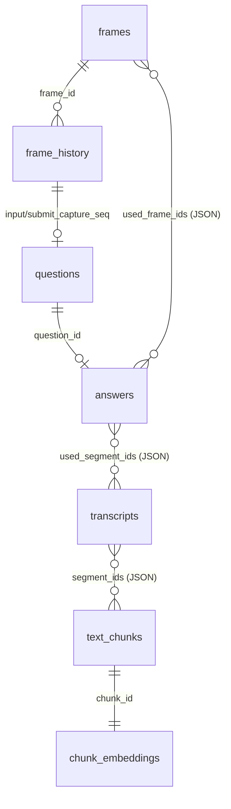

# 맥락 관리 DB 설계 (`metadata.db`)

> 이 문서는 `scripts/gen_db_doc.py`가 `context_qa/store.py`의 `SCHEMA`·`ADDED_COLUMNS`에서 만든다. 직접 고치지 말고 `.\.venv\Scripts\python.exe -m scripts.gen_db_doc`로 다시 만든다. `tests/test_context_db_doc.py`가 코드와 문서가 같은지 검사한다.

- 위치: `sessions/<session_id>/metadata.db` (세션마다 파일 1개)
- 쓰기 주체: **맥락 관리 모듈(`context_qa.ContextStore`)만** 쓴다. 다른 모듈은 큐로 이벤트를 보내고 직접 쓰지 않는다
- 모든 테이블의 키 첫 열은 `session_id`
- 시각은 모두 세션 공통 시계 기준 ms(일시정지 구간 제외)
- 연결 1개 + 잠금, WAL 모드. 컬럼이 추가되면 기존 DB를 열 때 자동으로 `ALTER TABLE ... ADD COLUMN`

## 테이블 관계

외래 키 제약은 걸지 않는다. 수집 이벤트가 도착 순서와 다르게 들어와도 저장이 실패하지 않게 하기 위해서다. JSON 배열 열은 조회 시 코드에서 풀어 쓴다.

## 테이블

### `frames`

저장된 이미지 1장당 1행. 정기 캡처 중 `reused`는 행을 만들지 않고 질문 스냅샷은 항상 새 행.

- 기본 키: (session_id, frame_id)
- 인덱스: 없음

| 열 | 타입 | NULL | 기본값 | 설명 |
|---|---|---|---|---|
| `session_id` **PK** | TEXT | 아니오 |  | 세션 ID |
| `frame_id` **PK** | TEXT | 아니오 |  | 이미지 식별자 |
| `image_path` | TEXT | 아니오 |  | `frames/...` 세션 폴더 기준 상대 경로 |
| `frame_type` | TEXT | 아니오 |  | `Text` / `Visual` / `Unknown` |
| `source` | TEXT | 아니오 |  | `periodic` / `question_start` / `question_submit` |
| `decision` | TEXT | 아니오 |  | `new_group` / `new_representative` / `question_snapshot` |
| `group_id` | TEXT | 예 |  | 유사 화면 묶음. 질문 스냅샷은 NULL |
| `first_capture_seq` | INTEGER | 아니오 |  | 이 이미지를 처음 관측한 캡처 번호 |
| `first_timestamp_ms` | INTEGER | 아니오 |  | 처음 관측 시각(세션 시계 ms) |

### `frame_history`

캡처 관측 1회당 1행. 중복(`reused`) 관측도 기록해 시점별로 어떤 화면이었는지 복원.

- 기본 키: (session_id, capture_seq)
- 인덱스: `idx_frame_history_time` (session_id, timestamp_ms)

| 열 | 타입 | NULL | 기본값 | 설명 |
|---|---|---|---|---|
| `session_id` **PK** | TEXT | 아니오 |  | 세션 ID |
| `capture_seq` **PK** | INTEGER | 아니오 |  | 세션 내 캡처마다 고유한 번호 |
| `frame_id` | TEXT | 아니오 |  | 이 관측이 가리키는 `frames.frame_id` |
| `timestamp_ms` | INTEGER | 아니오 |  | 관측 시각 |
| `source` | TEXT | 아니오 |  | `frames.source`와 같은 값 |
| `decision` | TEXT | 아니오 |  | `reused` 포함 |
| `group_id` | TEXT | 예 |  | 유사 화면 묶음 |

### `transcripts`

확정 발화 1개당 1행.

- 기본 키: (session_id, segment_id)
- 인덱스: `idx_transcripts_time` (session_id, end_ms)

| 열 | 타입 | NULL | 기본값 | 설명 |
|---|---|---|---|---|
| `session_id` **PK** | TEXT | 아니오 |  | 세션 ID |
| `segment_id` **PK** | TEXT | 아니오 |  | 발화 식별자 |
| `start_ms` | INTEGER | 아니오 |  | 발화 시작 시각 |
| `end_ms` | INTEGER | 아니오 |  | 발화 끝 시각. 질문 시점 컷오프 기준 |
| `text` | TEXT | 아니오 |  | 전사 본문 |

### `questions`

학생 질문 1개당 1행.

- 기본 키: (session_id, question_id)
- 인덱스: 없음

| 열 | 타입 | NULL | 기본값 | 설명 |
|---|---|---|---|---|
| `session_id` **PK** | TEXT | 아니오 |  | 세션 ID |
| `question_id` **PK** | TEXT | 아니오 |  | 질문 식별자 |
| `text` | TEXT | 아니오 |  | 질문 본문 |
| `input_started_ms` | INTEGER | 아니오 |  | 입력 시작 시각 |
| `submitted_ms` | INTEGER | 아니오 |  | 제출 시각. 이 시각 이후 자료는 답변에 쓰지 않음 |
| `input_capture_seq` | INTEGER | 아니오 |  | 질문 시작 스냅샷의 `frame_history.capture_seq` |
| `submit_capture_seq` | INTEGER | 아니오 |  | 제출 스냅샷의 `frame_history.capture_seq` |
| `question_type` | TEXT | 예 |  | `current_visual` / `past` / `general` 등 분류 결과 (자동 추가 열) |

### `answers`

질문 1개당 종료 결과 1행(완료·취소·실패).

- 기본 키: (session_id, question_id)
- 인덱스: 없음

| 열 | 타입 | NULL | 기본값 | 설명 |
|---|---|---|---|---|
| `session_id` **PK** | TEXT | 아니오 |  | 세션 ID |
| `question_id` **PK** | TEXT | 아니오 |  | `questions.question_id` |
| `answer` | TEXT | 아니오 |  | 완료 답변 또는 취소 시 부분 답변, 실패 시 빈 문자열 |
| `context_tag` | INTEGER | 예 |  | 연속 대화 태그(P1 예정) |
| `used_frame_ids` | TEXT | 아니오 |  | 모델에 보낸 이미지 `frame_id` JSON 배열(보낸 순서) |
| `used_segment_ids` | TEXT | 아니오 |  | 모델에 보낸 전사 `segment_id` JSON 배열 |
| `first_response_latency_ms` | INTEGER | 예 |  | 첫 조각까지 걸린 시간 |
| `elapsed_ms` | INTEGER | 아니오 |  | 종료까지 걸린 시간 |
| `status` | TEXT | 아니오 | 'completed' | `completed` / `cancelled` / `failed` (자동 추가 열) |
| `error_code` | TEXT | 예 |  | 실패 코드 (자동 추가 열) |
| `input_tokens` | INTEGER | 예 |  | 입력 토큰 (자동 추가 열) |
| `output_tokens` | INTEGER | 예 |  | 출력 토큰 (자동 추가 열) |
| `model` | TEXT | 예 |  | 사용 모델 (자동 추가 열) |
| `strategy` | TEXT | 예 |  | 맥락 선택 전략(`full` 등, 평가 시 A~D) (자동 추가 열) |

### `text_chunks`

RAG가 만든 검색 청크 1개당 1행.

- 기본 키: (session_id, chunk_id)
- 인덱스: 없음

| 열 | 타입 | NULL | 기본값 | 설명 |
|---|---|---|---|---|
| `session_id` **PK** | TEXT | 아니오 |  | 세션 ID |
| `chunk_id` **PK** | TEXT | 아니오 |  | RAG 청크 식별자 |
| `start_ms` | INTEGER | 아니오 |  | 청크 시작 시각 |
| `end_ms` | INTEGER | 아니오 |  | 청크 끝 시각. 검색 시 `end_ms <= 제출 시각`만 사용 |
| `text` | TEXT | 아니오 |  | 청크 본문 |
| `segment_ids` | TEXT | 아니오 |  | 포함한 `transcripts.segment_id` JSON 배열 |

### `chunk_embeddings`

청크 1개당 임베딩 1행.

- 기본 키: (session_id, chunk_id)
- 인덱스: 없음

| 열 | 타입 | NULL | 기본값 | 설명 |
|---|---|---|---|---|
| `session_id` **PK** | TEXT | 아니오 |  | 세션 ID |
| `chunk_id` **PK** | TEXT | 아니오 |  | `text_chunks.chunk_id` |
| `embedding_model` | TEXT | 아니오 |  | 임베딩 모델 이름. 다르면 복원하지 않음 |
| `dim` | INTEGER | 아니오 |  | 벡터 차원 |
| `vector` | BLOB | 아니오 |  | float64 배열 바이트 |

## 중복 방지 규칙

| 대상 | 규칙 |
|---|---|
| 모든 테이블 | 기본 키 충돌 시 `INSERT OR IGNORE`로 기존 행 유지, 오류 없음 |
| `frames` | `decision = reused` 관측은 `frames`에 쓰지 않고 `frame_history`에만 기록 |
| `frame_history` | 같은 `capture_seq` 재전송은 무시 |
| `transcripts` | 같은 `segment_id`는 무시하고 RAG에도 다시 보내지 않음 |
| `answers` | 질문당 1행. 종료 이벤트가 하나뿐이므로 덮어쓰지 않음 |
| `chunk_embeddings` | `text_chunks`에 새로 들어간 청크만 저장 |
| 세션 | 다른 `session_id` 이벤트는 저장하지 않고 `db_write_failed` 보고 |

## 질문 1건이 만드는 행

학생이 30:00에 "아까 설명한 스택 프레임이 뭐였지?"를 제출하고 답변이 완료된 경우:

| 테이블 | 행 수 | 내용 |
|---|---|---|
| `frames` | 2 | 질문 시작·제출 스냅샷(`source = question_start / question_submit`, `decision = question_snapshot`) |
| `frame_history` | 2 | 위 두 캡처의 관측 기록 |
| `questions` | 1 | 질문 본문, `submitted_ms = 1800000`, `question_type = past` |
| `answers` | 1 | `status = completed`, 사용한 프레임·전사 ID, 지연, 토큰, 모델, `strategy = full` |
| `transcripts`, `text_chunks`, `chunk_embeddings` | 0 | 질문은 만들지 않음. 수집·인덱싱 과정에서만 생김 |

취소되면 `answers.status = cancelled`와 부분 답변, 실패하면 `status = failed`와 `error_code`가 남는다. 이전 대화로는 `completed`만 쓴다.
